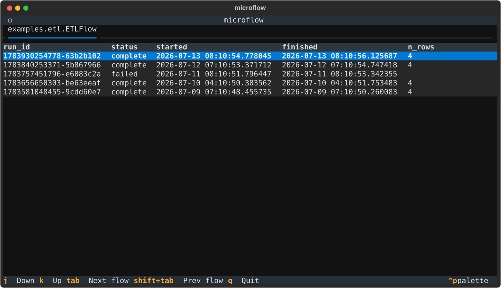
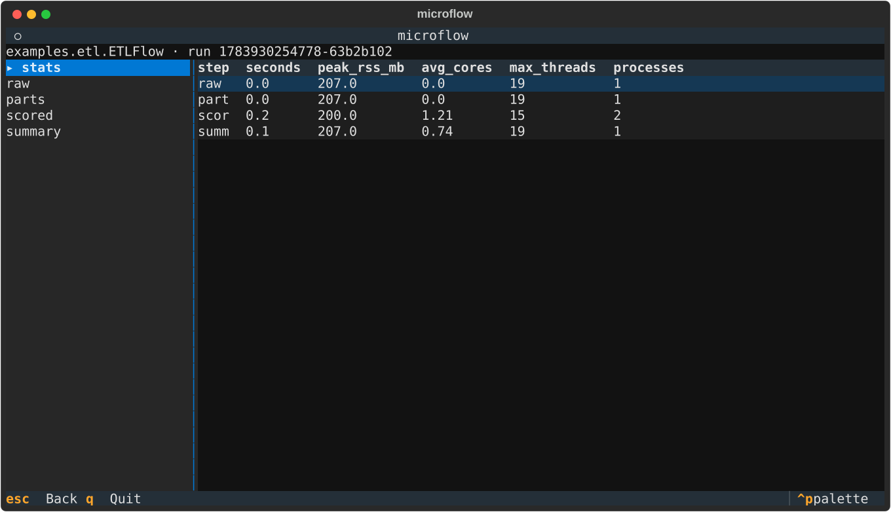

```
|  |   _
|  |  /
|  |  +-
|__|  |
|     /
```

# ionflow

A barebones [Metaflow](https://metaflow.org) alternative. A **flow is a class**, a
**step is a method**, and every step returns a **typed table** that ionflow persists
as Parquet on S3. No Kubernetes, no scheduler, no metadata server — the only thing you
configure is one S3-compatible bucket.

- **The DAG is the method signatures.** A step's parameters name its upstream steps.
  No `self.next(...)`.
- **Schemas are declared, enforced, and queryable.** Each output table is a class;
  DuckDB validates types / `NOT NULL` / `CHECK` on write and exposes every run as SQL.
- **Runs are logged in an append-only ledger** in the bucket: `run_id`, `status`
  (`running` / `complete` / `failed`), `started`, `finished`, git `commit`,
  `steps_complete`, plus any flow-specific columns.
- **Fan-out / fan-in** over N inputs, in parallel, on one machine. Transient branch
  failures (flaky S3) retry in place: `run(branch_retries=1)`.
- **Resumable**: `run --resume <run_id>` re-runs a failed run, reusing every step
  that already completed — including individual branches of a partially-failed
  fan-out; `run --resume latest` makes growing-corpus runs incremental.
- **Clean git required.** ionflow refuses to start with a dirty working tree, so every
  run is pinned to a commit.

## Install

```bash
uv add ionflow    # or: pip install ionflow
```

## Configure (the only setup)

Run the wizard once per repo:

```bash
ionflow setup
```

It asks for your bucket (and optional prefix / endpoint / region) and writes them to
`.ionflow/config` at the repo root — a small TOML file, no secrets in it. It also asks
whether to gitignore `.ionflow/` (keep it local) or commit it (share with your team).
Re-run `ionflow setup` any time to change it.

**Credentials** come from the standard AWS chain (environment variables, `~/.aws/credentials`,
or an IAM role) and are never written to the repo. `ionflow setup` just checks they resolve
and that the bucket is reachable. Any command guides you into `setup` if the repo isn't
configured yet.

```
# .ionflow/config
bucket   = "my-bucket"
prefix   = "ionflow"
endpoint = "https://…"   # omit for AWS S3; set for MinIO / R2
region   = "us-east-1"
```

## A complete flow

A miniature embedding pipeline — a job every data or ML team has run in some
form. `docs` **loads** a table of documents, `by_source` **fans out** into one
table per source, `vectors` **embeds** each source's documents **in parallel**
(numpy in, numpy out), and `summary` **fans in** to a single summary table. The
model is a stand-in that hashes each text into a vector, so the flow runs
as-is; everything else is the real shape of such a pipeline. Note there is no
wiring code — `vectors` depends on `by_source` purely because it has a
parameter named `by_source`.

```python
import hashlib

import numpy as np
import pyarrow as pa
from ionflow import Branch, Collect, Fanout, Flow, LedgerColumns, Table, check, primary_key, shaped


# --- Output schemas: annotations, compiled to DuckDB DDL on write ---
# A bare type is NOT NULL; `T | None` is nullable. Constraints attach as
# defaults: `= primary_key`, `= check("...")`, `= field(...)`.
class Doc(Table):
    doc_id: int = primary_key
    source: str
    text: str


class DocVector(Table):
    doc_id: int
    source: str
    embedding: shaped(np.float32, 64)      # fixed shape: a wrong-length row fails the write
    norm: np.float32 = check("norm >= 0")  # narrow dtypes persist as-is (FLOAT, not DOUBLE)


class Summary(Table):
    n_sources: int
    n_docs: int
    avg_norm: float


class EmbedDocs(Flow):
    # Extra ledger columns, populated during the run (small metadata only).
    class Ledger(LedgerColumns):
        n_docs: int

    def docs(self) -> Doc:                              # root step (only `self`)
        return pa.table({
            "doc_id": [1, 2, 3, 4],
            "source": ["wiki", "wiki", "arxiv", "arxiv"],
            "text": ["ducks type", "tables persist", "vectors search", "flows fan out"],
        })

    def by_source(self, docs: Doc) -> Fanout[Doc]:      # fan-out: one table per source;
        sources = [s for (s,) in                        # partitioning reuses the schema
                   docs.project("source").distinct().order("source").fetchall()]
        return [docs.filter(f"source = '{s}'") for s in sources]

    def vectors(self, by_source: Branch[Doc]) -> DocVector:     # once per branch, in parallel
        texts = by_source.np("text")                            # numpy in: one column as ndarray
        vecs = np.stack([                                       # stand-in for a real model
            np.frombuffer(hashlib.sha512(t.encode()).digest(), np.uint8) for t in texts
        ]).astype(np.float32)                                   # (n, 64) float32
        return {"doc_id": by_source.np("doc_id"),               # numpy out: dict of ndarrays,
                "source": by_source.np("source"),               # the 2D one becomes the
                "embedding": vecs,                              # fixed-size-list column
                "norm": np.linalg.norm(vecs, axis=1)}

    def summary(self, vectors: Collect[DocVector], docs: Doc) -> Summary:  # fan-in
        self.n_docs = docs.aggregate("count(*) AS c").fetchone()[0]        # -> ledger column
        return vectors.aggregate(
            "count(DISTINCT source) AS n_sources, count(*) AS n_docs, avg(norm) AS avg_norm")
```

Columns can also be variable-length lists: `embedding: list[float]` maps to
DuckDB `DOUBLE[]` / Arrow `list<double>` (nesting works too), so vectors never
need to be widened into hundreds of scalar columns.

Wide or generated schemas don't have to be written out by hand —
`Table.make("FullAnnotation", {"peptide": str, **{f"frag_{i}": float | None for i in range(200)}})`
builds the same kind of class programmatically.

Step inputs arrive as **lazy DuckDB relations** over the Parquet on S3 — column and
filter pushdown included, so a step only pulls what its query touches and memory
stays at the query's working set, not the input's size. Stay in SQL (`.aggregate`,
`.filter`, `.project`) or materialize with `.pl()` / `.df()` / `.to_arrow_table()`
and return any of those. Outputs stream too: validated and written to a local
temp file, then multipart-uploaded — a step's output can exceed RAM and S3's
5GB single-PUT limit.

### numpy in, numpy out

The `vectors` step above lives in numpy, as steps doing signal processing,
point clouds, or spectra do — none of them need conversion scaffolding in
either direction:

- **Returning:** a dict of ndarrays (2D+ values become fixed-size-list columns,
  zero-copy), a structured array, or a bare ndarray mapped onto the declared
  columns — all convert automatically, dtypes preserved: `float32` stays `FLOAT`
  on S3 instead of doubling to `DOUBLE`.
- **Reading:** inputs are still lazy relations (`.filter`, `.aggregate`, ...);
  `.np("col")` materializes one column as an ndarray — scalars 1D with their
  stored dtype, rectangular list columns stacked to `(N, d, ...)` — and `.np()`
  returns every column as a dict in one scan. Ragged or NULL-bearing columns raise instead
  of degrading to object arrays. Filter/project first when the input is large.
- **Shapes:** `shaped(np.float32, 64)` compiles to a DuckDB fixed array
  (`FLOAT[64]`), so shape violations fail at write time. Parquet round-trips
  fixed arrays as plain lists — queries and `.np()` see an ordinary list column.
- **NaN is a value, not NULL:** a `NOT NULL` float column accepts NaN (SQL
  semantics — usually what measurement data wants).
- **Complex arrays** have no parquet type; store `np.real` / `np.imag` as two
  columns (the error message says so too).

numpy is optional, not a ionflow dependency — these paths light up when your
project has it installed.

## Run it

```python
run_id = EmbedDocs.run()        # reads .ionflow/config (or pass config=Config(...))
```

or from the shell:

```bash
ionflow run mymodule:EmbedDocs
```

Sizing knobs (mirroring the Python API): `--max-workers N`
caps parallel branch workers — peak memory is roughly workers × one branch's working
set — `--threads` runs branches in threads instead of processes, and
`--branch-retries N` retries a failed branch in its worker before giving up.

## Parameters

Typed run inputs, declared like everything else — annotations on an inner class.
A bare type is required; a class value is the default.

```python
from ionflow import FlowParams

class Training(Flow):
    class Params(FlowParams):
        dataset: str          # required
        batch_size: int = 32

    def load(self) -> Raw:
        return read(self.dataset)          # params are bound to self
```

```bash
ionflow run mymodule:Training -p dataset=d1 -p batch_size=64
```

```python
Training.run(params={"dataset": "d1"})
```

Every param becomes a **ledger column** (queryable per run, recorded from the moment
the run starts) and is stored in the run's meta; `resume` always reuses the origin
run's params. Types are limited to `int`/`float`/`str`/`bool` so params round-trip
JSON, parquet, and the command line.

## Query every run as one database

`duck()` returns a DuckDB connection with a **view per step table** plus a `ledger` view.
Views glob every run, so a new run shows up with nothing to sync — `run_id` is a column.

```python
con = EmbedDocs.duck()
con.sql("SELECT run_id, avg_norm FROM summary ORDER BY run_id").show()
con.sql("SELECT source, norm FROM vectors WHERE run_id = ? ", params=[run_id]).show()
con.sql("SELECT run_id, started, finished, n_docs FROM ledger").show()
```

```bash
ionflow query mymodule:EmbedDocs "SELECT * FROM summary"
ionflow ls mymodule:EmbedDocs
```

## Browse in the terminal (TUI)

Bare `ionflow` (no subcommand) opens an interactive terminal UI (the screenshots
show the small ETL flow from this repo's `examples/etl.py`):

```bash
ionflow
```



- one **tab per Flow** in your project (point `ionflow setup` at your `flows` package —
  every `Flow` subclass auto-registers on import),
- each tab is a table of that flow's runs: `run_id`, `status`, `started`, `finished`, **plus
  that flow's custom ledger columns**,
- `Tab` cycles flows; `j`/`k`/PageUp/PageDown move the row cursor,
- **Enter** drills into a run to preview each step's output table; **Esc** goes back.

The drill-down opens on the run's resource stats (the same numbers as `ionflow stats`):



and selecting a step previews its output table — here `region_totals`, one row per fan-out branch:


On startup it re-discovers your flows and warns if a flow's declared table schema has drifted
from what's stored on S3, or if there's run data on S3 with no matching Flow in code. If the
repo isn't configured yet, the TUI opens a setup screen first.

## Resource metrics

Every run records CPU and memory for every step and branch — always on, negligible
overhead, one small `_metrics.parquet` per run. Sampling is adaptive (1s at start,
interval doubles when the 1024-sample cap folds the buffer), so even multi-day runs
stay bounded while peaks are preserved.

```bash
ionflow stats mymodule:EmbedDocs          # per-step: seconds, peak_rss_mb, avg_cores,
                                           # max_threads (defaults to the latest run)
ionflow query mymodule:EmbedDocs "SELECT * FROM metrics WHERE step='vectors'"
```

The same summary appears in the TUI run drill-down ("stats" entry), and the raw
time series is the `metrics` SQL view (`ts, step, branch, rss, threads, cpu_user,
cpu_system, run_id`). Failed runs keep their metrics.

The buffer is flushed to S3 every 60s while the run executes, so metrics survive
hard kills (OOM, SIGKILL) up to the last minute and you can watch a running step's
memory live from another client (orchestrator process; process-mode branch samples
arrive with the final write). The flush also doubles as a **heartbeat**: `ls`
and the TUI show `running (stale?)` for runs whose heartbeat has been quiet for
5+ minutes — the honest state for a process that was killed without cleanup.

## Prototyping

Iterating on a flow fights the production guarantees (clean git, declared schemas,
immutable history). Mark a flow as a prototype to relax them — visibly, in code:

```python
from ionflow import Flow, Prototype

class Scratch(Prototype, Flow):
    def numbers(self):              # untyped step: schema inferred at write
        return pa.table({"x": [1, 2, 3]})

    def total(self, numbers) -> Totals:   # typed steps still validate as usual
        return numbers.aggregate("count(*) AS n, sum(x) AS total")
```

Prototype flows:

- run in a **scratch namespace** (`<prefix>/_proto/<flow_id>/…`) — stable views, drift
  checks, and other clients never see the churn, and stable data is never touched;
- may run from a **dirty git tree** (ledger records `dirty:<sha>`);
- may **omit step output schemas** (untyped steps can't fan out — annotate
  `Fanout[...]` for that);
- tolerate ledger schema churn (a conflicting old scratch ledger is reset);
- can be wiped: `ionflow clean mymodule:Scratch` (refused for stable flows —
  deletion is explicit and scratch-only, never a side effect of running).

Remove the mixin to promote: the flow points back at the stable namespace, and every
guarantee applies again from the first stable run. Untyped steps in a non-prototype
flow are a **class-definition error**.

## Resume

```bash
ionflow run mymodule:EmbedDocs --resume <origin_run_id>   # API: EmbedDocs.run(resume=run_id)
```

A **new** `run_id` is created; completed step outputs are copied from the origin run
(server-side, no re-compute) and execution restarts at the first incomplete step. A
partially-failed fan-out re-runs only its failed branches.

If HEAD differs from the origin run's commit, resume **refuses by default** — reused
steps would keep their old-code outputs, mixing two commits in one run. Pass
`--allow-commit-drift` (API: `allow_commit_drift=True`) to proceed deliberately;
prototype flows only warn, since they relinquish provenance anyway.

## Incremental runs (growing corpora)

For a corpus that grows file-by-file, declare which column identifies a fan-out item —
its **fanout key** — and resume stops matching branches by position and starts matching
them by identity:

```python
class RawFile(Table):
    path: str = fanout_key               # one distinct value per fan-out item
    size: int

class Annotate(Flow):
    def files(self) -> Fanout[RawFile]:
        return [one_file_manifest(f) for f in list_raw_files(self.config)]

    def annotate(self, files: Branch[RawFile]) -> Annotated: ...
```

```bash
ionflow run mymodule:Annotate --resume latest
```

`--resume latest` resumes from the latest complete run (a first run is a normal full run).
The fan-out re-runs to pick up the current work-list; branch outputs whose key already
exists in the origin are **server-side copied**, only new keys compute, and removed keys
drop out. Downstream steps (the fan-in and beyond) recompute whenever the key set
changed. The result is still one complete, immutable run folder — adding 5 files to 500
costs 5 files' compute, and `SELECT ... WHERE run_id = <new>` is always the full corpus.

The key is a contract: **same key must mean same content**. If a source file can be
re-uploaded in place, put its etag (or mtime) in the key column. The commit gate applies
unchanged — after a code change, run without `--resume` to recompute the corpus, or
force with `--allow-commit-drift` to keep old-code outputs.

## Publish (stable paths for consumers)

Run outputs live in immutable `run_id=` folders. Consumers that just want "the current
training set at a fixed path" — a trainer, a cron job, another team — shouldn't need
ionflow or a run_id:

```bash
ionflow publish mymodule:Annotate <run_id> annotate s3://bucket/stable/training.parquet \
    --where "split = 'training'"
```

This copies the step's output (optionally filtered) to one parquet object plus a
`<dest>.meta.json` sidecar recording flow, run_id, commit, filter, and publish time.
An existing destination is refused unless you pass `--force` (replacing is a single
atomic PUT). Note that two related files published one after the other can be observed
mid-swap — consumers needing cross-file consistency should compare the sidecars' run_id.

## Storage layout

```
s3://<bucket>/<prefix>/<flow_id>/          # flow_id = module-qualified class name,
  ledger.parquet                           #   e.g. mymodule.EmbedDocs
  runs/                                    # ledger: append-only, updated via S3 CAS
    run_id=<id>/
      _meta.json                           # live run state (progress, custom columns)
      docs/part_0.parquet
      by_source/part_0.parquet   by_source/part_1.parquet
      vectors/part_0.parquet     vectors/part_1.parquet
      summary/part_0.parquet
```

Run folders are immutable, which is why no catalog database is needed — DuckDB reads the
Parquet directly and the ledger uses an S3 conditional-write (`If-Match`) for safe
concurrent appends.

A flow's durable identity is its **module-qualified class name** (`flow_id`), so
same-named classes in different modules never share data. The flip side: renaming a
flow class *or* moving it to another module makes it a new flow — old runs stay under
the old id.

## Tutorial: every feature in one flow

A ten-minute tour. One small flow — count words across a growing set of documents —
touches everything above: typed tables with constraints, fan-out/fan-in, params,
custom ledger columns, querying, resource stats, incremental runs via a fanout key,
and publishing. Save it as `tutorial.py` in a configured repo (`ionflow setup`),
commit, and follow along.

```python
"""tutorial.py — one flow that touches every ionflow feature."""

import pyarrow as pa

from ionflow import (
    Branch, Collect, Fanout, Flow, FlowParams,
    LedgerColumns, Table, check, fanout_key, primary_key,
)

# Stand-in for external inputs. Real flows would list files in a bucket or
# read a manifest here — see the incremental note below.
CORPUS = {
    "docs/zen.txt": "simple is better than complex",
    "docs/fox.txt": "the quick brown fox jumps over the lazy dog",
}


class Doc(Table):
    path: str = fanout_key              # item identity -> incremental resume
    text: str


class WordCount(Table):
    path: str
    word: str = primary_key             # unique within each branch's output
    n: int = check("n >= 1")


class Report(Table):
    n_docs: int
    n_words: int
    top_word: str | None                # `T | None` = nullable column


class WordFlow(Flow):
    class Params(FlowParams):           # typed run inputs, bound to `self`
        min_count: int = 1

    class Ledger(LedgerColumns):        # extra queryable ledger columns
        distinct_words: int

    def docs(self) -> Fanout[Doc]:      # root fan-out: one table per item
        return [pa.table({"path": [p], "text": [t]}) for p, t in sorted(CORPUS.items())]

    def counts(self, docs: Branch[Doc]) -> WordCount:   # once per doc, in parallel
        words = docs.project("path, unnest(string_split(text, ' ')) AS word")
        return words.aggregate("path, word, count(*) AS n").filter(f"n >= {self.min_count}")

    def report(self, counts: Collect[WordCount]) -> Report:   # fan-in
        self.distinct_words = counts.aggregate("count(DISTINCT word) AS c").fetchone()[0]
        return counts.aggregate(
            "count(DISTINCT path) AS n_docs, sum(n)::BIGINT AS n_words, arg_max(word, n) AS top_word"
        )
```

Notice what's *not* here: no wiring (`counts` depends on `docs` because its parameter
is named `docs`), no schema DDL (the `Table` classes compile to DuckDB constraints,
validated on every write), no S3 paths, no serialization code.

**1. Run it.** Params come in with `-p`; each fan-out branch runs in its own worker
process (cap with `--max-workers`, retry flaky branches with `--branch-retries`):

```bash
$ ionflow run tutorial:WordFlow -p min_count=1
1784996729416-c93d0d1b                              # the new run_id
```

A dirty working tree would have been refused — the run is pinned to your commit.
If a branch had failed, `ionflow run tutorial:WordFlow --resume <run_id>` would
re-run only the incomplete branches into a fresh run, copying the finished ones.

**2. Query it.** Every step is a SQL view spanning all runs (`run_id` is a column),
and the ledger — including your params and custom columns — is a view too:

```bash
$ ionflow query tutorial:WordFlow "SELECT * FROM report"
┌────────┬─────────┬──────────┬────────────────────────┐
│ n_docs │ n_words │ top_word │         run_id         │
├────────┼─────────┼──────────┼────────────────────────┤
│      2 │      14 │ the      │ 1784996729416-c93d0d1b │
└────────┴─────────┴──────────┴────────────────────────┘

$ ionflow query tutorial:WordFlow "SELECT run_id, status, min_count, distinct_words FROM ledger"
┌────────────────────────┬──────────┬───────────┬────────────────┐
│         run_id         │  status  │ min_count │ distinct_words │
├────────────────────────┼──────────┼───────────┼────────────────┤
│ 1784996729416-c93d0d1b │ complete │         1 │             13 │
└────────────────────────┴──────────┴───────────┴────────────────┘
```

The same works in Python — `WordFlow.duck()` returns the connection — and bare
`ionflow` opens the TUI to browse runs and preview step outputs interactively.

**3. Check what it cost.** Metrics are always on:

```bash
$ ionflow stats tutorial:WordFlow
┌─────────┬─────────┬─────────────┬───────────┬─────────────┬───────────┐
│  step   │ seconds │ peak_rss_mb │ avg_cores │ max_threads │ processes │
├─────────┼─────────┼─────────────┼───────────┼─────────────┼───────────┤
│ docs    │     0.0 │       192.0 │       0.0 │          14 │         1 │
│ counts  │     0.6 │       208.0 │      1.08 │          15 │         2 │
│ report  │     0.1 │       213.0 │      0.75 │          19 │         1 │
└─────────┴─────────┴─────────────┴───────────┴─────────────┴───────────┘
```

The raw time series is the `metrics` view (`SELECT ts, rss FROM metrics WHERE step='counts'`).

**4. Grow the corpus.** Add a document to `CORPUS`, commit, and run incrementally.
Because `Doc.path` is the **fanout key**, resume matches branches by identity, not
position: the two old documents' outputs are server-side copied, only `cat.txt` is
counted, and the fan-in recomputes because the key set changed:

```bash
$ ionflow run tutorial:WordFlow --resume latest --allow-commit-drift
1784996755141-193f9a4b

$ ionflow query tutorial:WordFlow "SELECT run_id, n_docs, n_words FROM report ORDER BY run_id"
┌────────────────────────┬────────┬─────────┐
│         run_id         │ n_docs │ n_words │
├────────────────────────┼────────┼─────────┤
│ 1784996729416-c93d0d1b │      2 │      14 │
│ 1784996755141-193f9a4b │      3 │      20 │
└────────────────────────┴────────┴─────────┘
```

`--allow-commit-drift` is needed here only because this tutorial keeps its corpus
*in the code*, so adding a document changes the commit. A real incremental flow
lists external inputs (files in a bucket via `self.config`, a manifest, …), and
growing the corpus doesn't touch the repo — plain `--resume latest` suffices, and
the commit gate keeps guarding actual code changes.

**5. Publish for consumers.** Hand downstream users one stable path instead of a
run_id, with provenance in a sidecar:

```bash
$ ionflow publish tutorial:WordFlow 1784996755141-193f9a4b counts \
    s3://my-bucket/stable/wordcounts.parquet --where "n >= 2"
published tutorial.WordFlow/counts from run 1784996755141-193f9a4b to s3://my-bucket/stable/wordcounts.parquet
```

`wordcounts.parquet.meta.json` next to it records the flow, run_id, commit, filter,
and publish time.

**6. Iterate freely.** While reshaping the flow, add the `Prototype` mixin
(`class WordFlow(Prototype, Flow)`): runs move to a scratch namespace, a dirty git
tree is allowed, steps may omit their return annotation, and `ionflow clean
tutorial:WordFlow` wipes the scratch data. Remove the mixin to promote — every
guarantee applies again from the first stable run.

## Notes & limits

- **DuckDB-first**, DataFrame-optional. polars/pandas are conveniences, not dependencies.
- **One level of fan-out** (kept deliberately small).
- Reading from S3 uses DuckDB's `httpfs` extension, downloaded automatically on
  first use (one-time, per DuckDB version) — the very first run needs network
  access to the DuckDB extension repo.
- Parallel branch workers split the machine fairly: each worker's DuckDB is capped
  to its share of cores and memory and spills to disk instead of OOMing.
- **Backends**: AWS S3, MinIO (recent), Cloudflare R2. Backblaze B2 is unsupported (no
  `If-Match` conditional writes).
- Set custom ledger columns on non-branch (main-process) steps; branch steps run in
  separate processes and their `self` is not carried back.
- Steps can read **side inputs** (raw files that aren't step outputs) via `self.config`
  (e.g. `ionflow.storage.s3_client(self.config)`). Side inputs escape run provenance —
  record their identifiers as ledger columns.
