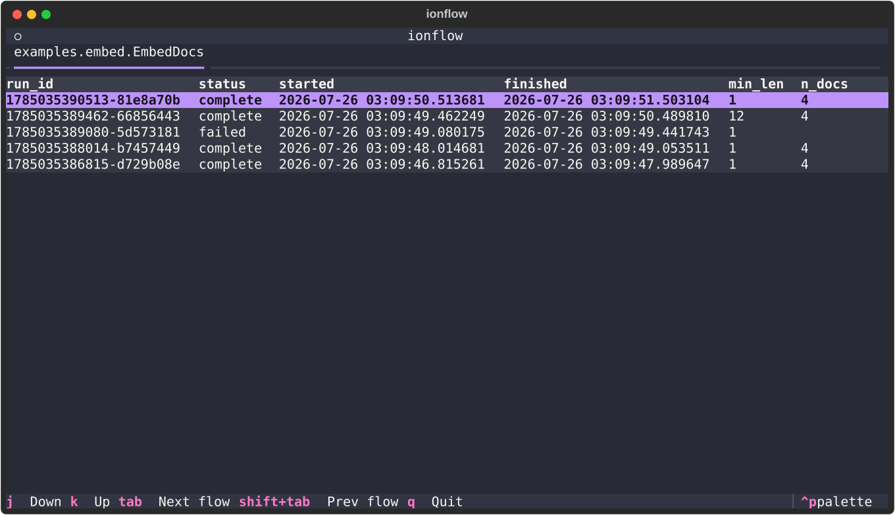
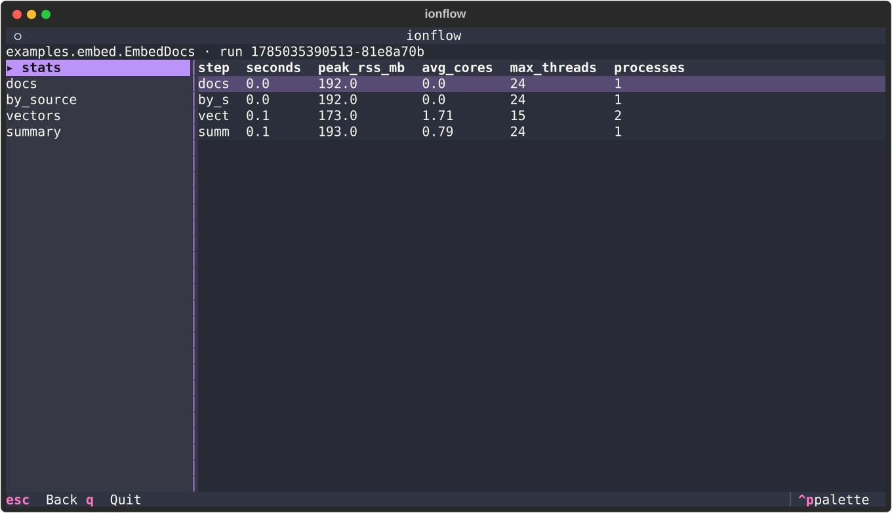
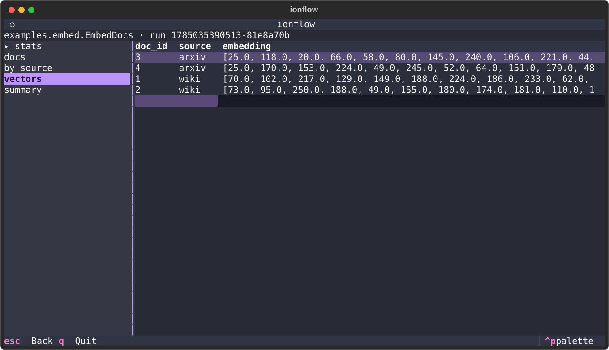

```
|  |   _
|  |  /
|  |  +-
|__|  |
|     /
```

# ionflow

A barebones [Metaflow](https://metaflow.org) alternative. A **flow is a class**, a
**step is a method**, and each step returns a **typed table or artifact**. Tables
persist as Parquet; artifacts are shared files or bundles. No Kubernetes, no
scheduler, no metadata server. Execution is local-first, with an optional S3 peer.

- **The DAG is the method signatures.** A step's parameters name its upstream steps.
  No `self.next(...)`.
- **Schemas are declared, enforced, and queryable.** Each output table is a class;
  DuckDB validates types / `NOT NULL` / `CHECK` on write and exposes every run as SQL.
- **Runs are logged in a ledger** inside the flow's catalog: `run_id`, `status`
  (`running` / `complete` / `failed`), `started`, `finished`, git `commit`,
  plus any flow-specific columns — committed atomically with the data they
  describe.
- **Fan-out / fan-in** over N inputs, in parallel, on one machine — and a branch can
  be a sub-DAG, run per item, with independent sub-steps concurrent. Transient branch
  failures (flaky S3) retry in place: `run(branch_retries=1)`.
- **Resumable**: `run --resume <run_id>` re-runs a failed run, reusing every step
  that already completed — down to a single sub-step of a single item of a
  partially-failed fan-out; `run --resume latest` makes growing-corpus runs incremental.
- **Clean git required.** ionflow refuses to start with a dirty working tree, so every
  run is pinned to a commit.

## Install

```bash
uv add ionflow    # or: pip install ionflow
```

## Configure (the only setup)

Run the wizard once per repo:

```bash
ionflow setup
```

The wizard creates a required local store and optionally connects a remote.
Settings live in `.ionflow/config`; credentials remain in the standard AWS chain.
Relative local paths resolve against the project root.

```toml
local_dir = ".ionflow/data"
prefix = "ionflow"
remote = "s3://my-bucket/ionflow"  # optional; a directory is also supported
region = "us-east-1"
# endpoint = "https://…"        # optional S3-compatible endpoint
```

All execution writes locally. S3 is never the execution store. A bucket-only
`Config` describes a low-level transfer endpoint, not a runnable workspace.
`ionflow setup --local` skips the remote prompt.

Metadata refresh shares ledger rows, descriptors, properties, bindings and lineage.
It copies no step tables, metrics or artifact blobs. The ledger and artifact
inventory include built-in `local` and `s3` Boolean columns. The TUI displays them
as local and S3, with ✓ for complete payloads and ○ for absent or incomplete ones.
Click an absent indicator to review and confirm that transfer direction.

```bash
ionflow refresh
ionflow sync mymodule:EmbedDocs --run RUN_ID --plan
ionflow sync mymodule:EmbedDocs --run RUN_ID --yes
ionflow sync mymodule:EmbedDocs --run RUN_ID --down --yes
ionflow sync --artifact TYPE:HASH --down --plan
```

Uploads and downloads include required artifact parents and reused table parts.
They do not include unrelated descendants. Plans show the source, destination,
missing file count and bytes. Omit `--yes` to confirm interactively.
`--to s3://bucket/prefix` selects an explicit upload destination.

Refresh is automatic during execution and while the TUI is open. `ls` and
`artifacts ls` also refresh metadata. Offline work stays usable; refresh errors
retain last-known inventory and presence. Reconnect and refresh to reconcile
pending changes. There is no permanent background daemon.

```python
from ionflow import Config, Storage

storage = Storage(Config.load())
storage.refresh()  # metadata only
plan = storage.plan("down", flow_id="mymodule.EmbedDocs", run_id="RUN_ID")
print(plan.summary())  # present this before approval
storage.transfer(plan)  # explicit payload transfer
```

A run is present when its committed snapshot and required dependencies are
available. An artifact is present when all payload members are available.
Metadata alone does not imply presence. Another workstation can advertise
metadata before uploading its payload, so both indicators can be absent.

Concurrent artifact edits are reported, never silently overwritten. Inspect
both revisions, then resolve explicitly without copying any payload:

```bash
ionflow artifacts show TYPE:HASH
ionflow artifacts show TYPE:HASH --s3
ionflow artifacts resolve TYPE:HASH --prefer local --local-revision 2 --s3-revision 2
```

Local stores coordinate processes on one host through a file lock. Do not use
one local directory as a multi-host shared drive. There is no legacy layout
or configuration migration; recreate development stores.

## Shared artifacts

Artifacts live independently of runs. A file's identity is its complete SHA-256.
A bundle's identity hashes a canonical manifest of relative filenames and file
digests. Shared files upload once, including files shared between bundles.
Names and metadata can change without changing an artifact's ID.

Run history lives at `<prefix>/runs/<flow_id>/run_id=<id>/`. Flow catalogs live
directly under their flow roots. Shared content lives at `<prefix>/artifacts/`;
the publish lake remains at `<prefix>/published/`. This pre-production layout
replaces the earlier layout without migration.

Declare stable types and named inputs:

```python
from ionflow import Artifact, ArtifactInputs, Artifacts, Config, Flow

class Fasta(Artifact, kind="fasta"):
    organism: str | None

class Library(Artifact, kind="example-library", payload="bundle"):
    model: str

class Predict(Flow):
    class Inputs(ArtifactInputs):
        fasta: Fasta

    def library(self, fasta: Fasta) -> Library:
        output = predict(fasta.local_path())
        return Library.from_path(output, model="7.2")

config = Config.load()
inventory = Artifacts(config)
fasta = inventory.put(Fasta.from_path("human.fasta", organism="human"))
run_id = Predict.run(config, artifacts={"fasta": fasta.id})
```

`predict` is application code that writes a library directory. The runner persists
the candidate before committing its output and lineage. Use
`members={"relative/name": source_path}` to select bundle members explicitly.
File symlinks resolve to shared content. Directory symlinks and unsafe relative
names are refused.

Metadata supports JSON scalars, optional values, lists, and dictionaries with
string keys. Class values supply defaults. Type identifiers, payload kinds, and
metadata schemas are stable contracts; use a new type for an incompatible schema.
Conflicting duplicate imports raise `MetadataConflict`. Edit metadata explicitly:

```python
renamed = inventory.update(fasta.id, revision=fasta.revision, name="reference")
assert renamed.id == fasta.id
```

Inputs support `list[ArtifactType]` and retain collection order.
`Fanout[ArtifactType]` keys items by full artifact ID;
`Branch[ArtifactType]` receives one reference; `Collect[ArtifactType]` receives
ordered references. Duplicate fan-out IDs are refused.

References expose `.id`, `.name`, `.metadata`, `.revision`, `.uri`, and
`.local_path()`. File URIs name the blob; bundle URIs name its descriptor.
Workspace references use local payloads. Missing payloads require an explicit
download before materialization or execution. Materialized paths are verified
and read-only. Build into a work directory.
`inventory.evict(id)` removes only the disposable local cache entry.

Table-producing steps can track dynamic inputs and side outputs:

```python
library = self.artifacts.use(library_ref, role="library")
index = self.artifacts.publish(index_candidate, role="index", parents=[library])
```

Publish inside a temporary-directory context before deleting its source files.
Returning that published reference from an artifact step retains its generation
record. Declared input references are also available as attributes on `self`.
Call `self.artifacts.use(ref)` when dynamically selecting one of those inputs.

Runs pin IDs and metadata snapshots. Lineage records use, generation, and reuse
per step and item. Ancestry survives intermediate tables. Several executions can
produce the same content; all production records remain. Resume inherits the
original bindings. Changed inputs require a fresh run. Sharing content does not
automatically cache arbitrary computations.

```python
inventory.parents(artifact_id)
inventory.producers(artifact_id)
inventory.consumers(artifact_id)
inventory.duck().sql("SELECT kind, count(*) FROM artifacts GROUP BY kind").show()
```

`Flow.duck()` also exposes `artifacts`, `artifact_files`, `artifact_bindings`,
`artifact_activity`, and `artifact_events`. Artifact-producing step views contain
IDs, names, typed metadata fields, item keys, and run IDs. Bindings describe
selected inputs; activities describe declared dependencies, not observed file reads.

The runnable [artifact example](examples/artifacts.py) counts shared documents
and produces a report:

```bash
ionflow artifacts add examples.artifacts:TextFile document.txt
ionflow run examples.artifacts:CountWords --artifact documents=TYPE:HASH
ionflow artifacts ls
ionflow artifacts show TYPE:HASH
ionflow artifacts path TYPE:HASH
ionflow artifacts lineage TYPE:HASH
ionflow artifacts update TYPE:HASH --revision 1 --name reference
ionflow artifacts query 'SELECT * FROM artifact_bindings'
ionflow artifacts sync TYPE:HASH --to s3://bucket/prefix --plan
ionflow sync examples.artifacts:CountWords --run RUN_ID --to s3://bucket/prefix --yes
ionflow artifacts recover
```

Repeat `--artifact NAME=ID` for collections. Import schemas use `module:ClassName`;
`--metadata` accepts a JSON object. Inventory queries need no consuming flow.

Explicit payload sync supports local and S3 stores and different prefixes. It copies
artifact parents and cross-run table parts before marking the receiving snapshot present.
Metadata conflicts are reported, not overwritten. Artifact-only sync carries
producer evidence even when its flow history is absent. Run catalogs take
precedence over those portable producer records.

`artifacts recover` rebuilds inventory from descriptors and immutable revision
exports. Use `--replace` to rebuild an existing registry. Run recovery also restores
bindings and lineage. Permanent deletion and automatic recipe caching are deferred.

## A complete flow

A miniature embedding pipeline — a job every data or ML team has run in some
form. `docs` **loads** a table of documents, `by_source` **fans out** into one
table per source, `vectors` **embeds** each source's documents **in parallel**
(numpy in, numpy out), and `summary` **fans in** to a single summary table. The
model is a stand-in that hashes each text into a vector, so the flow runs
as-is; everything else is the real shape of such a pipeline. Note there is no
wiring code — `vectors` depends on `by_source` purely because it has a
parameter named `by_source`. This one flow is the example for the whole README:
every section below — params, queries, the TUI, metrics, resume, incremental
runs, publish — works on it.

```python
import hashlib

import numpy as np
import pyarrow as pa
from ionflow import (Branch, Collect, Fanout, Flow, FlowParams, LedgerColumns,
                     Table, check, fanout_key, primary_key, shaped)


# --- Output schemas: annotations, compiled to DuckDB DDL on write ---
# A bare type is NOT NULL; `T | None` is nullable. Constraints attach as
# defaults: `= primary_key`, `= check("...")`, `= fanout_key`, `= field(...)`.
class Doc(Table):
    doc_id: int = primary_key
    source: str = fanout_key                # fan-out item identity ("Incremental runs" below)
    text: str


class DocVector(Table):
    doc_id: int
    source: str
    embedding: shaped(np.float32, 64)      # fixed shape: a wrong-length row fails the write
    norm: np.float32 = check("norm >= 0")  # narrow dtypes persist as-is (FLOAT, not DOUBLE)


class Summary(Table):
    n_sources: int
    n_docs: int
    avg_norm: float


class EmbedDocs(Flow):
    class Params(FlowParams):                           # typed run inputs, bound to `self`
        min_len: int = 1                                # skip docs shorter than this

    # Extra ledger columns, populated during the run (small metadata only).
    class Ledger(LedgerColumns):
        n_docs: int

    def docs(self) -> Doc:                              # root step (only `self`)
        return pa.table({
            "doc_id": [1, 2, 3, 4],
            "source": ["wiki", "wiki", "arxiv", "arxiv"],
            "text": ["ducks type", "tables persist", "vectors search", "flows fan out"],
        })

    def by_source(self, docs: Doc) -> Fanout[Doc]:      # fan-out: one table per source;
        docs = docs.filter(f"length(text) >= {self.min_len}")
        sources = [s for (s,) in                        # partitioning reuses the schema
                   docs.project("source").distinct().order("source").fetchall()]
        return [docs.filter(f"source = '{s}'") for s in sources]

    def vectors(self, by_source: Branch[Doc]) -> DocVector:     # once per branch, in parallel
        texts = by_source.np("text")                            # numpy in: one column as ndarray
        vecs = np.stack([                                       # stand-in for a real model
            np.frombuffer(hashlib.sha512(t.encode()).digest(), np.uint8) for t in texts
        ]).astype(np.float32)                                   # (n, 64) float32
        return {"doc_id": by_source.np("doc_id"),               # numpy out: dict of ndarrays,
                "source": by_source.np("source"),               # the 2D one becomes the
                "embedding": vecs,                              # fixed-size-list column
                "norm": np.linalg.norm(vecs, axis=1)}

    def summary(self, vectors: Collect[DocVector], docs: Doc) -> Summary:  # fan-in
        self.n_docs = docs.aggregate("count(*) AS c").fetchone()[0]        # -> ledger column
        return vectors.aggregate(
            "count(DISTINCT source) AS n_sources, count(*) AS n_docs, avg(norm) AS avg_norm")
```

Columns can also be variable-length lists: `embedding: list[float]` maps to
DuckDB `DOUBLE[]` / Arrow `list<double>` (nesting works too), so vectors never
need to be widened into hundreds of scalar columns.

Wide or generated schemas don't have to be written out by hand —
`Table.make("FullAnnotation", {"peptide": str, **{f"frag_{i}": float | None for i in range(200)}})`
builds the same kind of class programmatically.

Step inputs arrive as **lazy DuckDB relations** over local Parquet — column and
filter pushdown included, so a step only pulls what its query touches and memory
stays at the query's working set, not the input's size. Stay in SQL (`.aggregate`,
`.filter`, `.project`) or materialize with `.pl()` / `.df()` / `.to_arrow_table()`
and return any of those. Outputs stream too: validated and written to a local
temp file, then multipart-uploaded — a step's output can exceed RAM and S3's
5GB single-PUT limit.

### numpy in, numpy out

The `vectors` step above lives in numpy, as steps doing signal processing,
point clouds, or spectra do — none of them need conversion scaffolding in
either direction:

- **Returning:** a dict of ndarrays (2D+ values become fixed-size-list columns,
  zero-copy), a structured array, or a bare ndarray mapped onto the declared
  columns — all convert automatically, dtypes preserved: `float32` stays `FLOAT`
  on S3 instead of doubling to `DOUBLE`.
- **Reading:** inputs are still lazy relations (`.filter`, `.aggregate`, ...);
  `.np("col")` materializes one column as an ndarray — scalars 1D with their
  stored dtype, rectangular list columns stacked to `(N, d, ...)` — and `.np()`
  returns every column as a dict in one scan. Ragged or NULL-bearing columns raise instead
  of degrading to object arrays. Filter/project first when the input is large.
- **Shapes:** `shaped(np.float32, 64)` compiles to a DuckDB fixed array
  (`FLOAT[64]`), so shape violations fail at write time. Parquet round-trips
  fixed arrays as plain lists — queries and `.np()` see an ordinary list column.
- **NaN is a value, not NULL:** a `NOT NULL` float column accepts NaN (SQL
  semantics — usually what measurement data wants).
- **Complex arrays** have no parquet type; store `np.real` / `np.imag` as two
  columns (the error message says so too).

numpy is optional, not a ionflow dependency — these paths light up when your
project has it installed.

### A branch can be a sub-DAG

A branch does not have to be one method. `Branch[T]` names the upstream *step*, so
branch steps chain, and steps that branch over the same output are independent —
which makes one fan-out item a small DAG of its own:

```python
class Search(Flow):
    def by_job(self, manifest: Job) -> Fanout[Job]: ...
    def convert(self, by_job: Branch[Job]) -> Converted: ...          # .raw -> .db
    def upload_db(self, convert: Branch[Converted]) -> Uploaded: ...  # ┐ concurrent,
    def search(self, convert: Branch[Converted]) -> Psm: ...          # ┘ same item
    def report(self, search: Collect[Psm]) -> Report: ...             # fan-in, as usual
```

That sub-DAG runs **per item, not per stage**: one worker takes an item from
`convert` all the way to `search` while another worker is still converting its own,
and `upload_db` and `search` run at the same time within an item. Two consequences
worth designing around:

- **Intermediates scale with `--max-workers`, not with the work-list.** A stage
  barrier would convert every raw file before searching any, and put N `.db` files on
  disk at once.
- **An item's sub-steps share one process**, so they can hand each other large local
  artifacts by path — `convert` writes the `.db`, `upload_db` and `search` read it —
  instead of round-tripping through S3.

Retry and resume are as granular as the DAG: `--branch-retries` re-runs the sub-step
that failed, and `--resume` restarts an item at its first incomplete sub-step. A flaky
upload costs one upload, not the 40-minute search beside it.

A side-effecting sub-step still returns a table — that is the point. `upload_db`
produces no rows of its own, so it returns one row saying what it wrote (uri, etag),
turning an invisible side effect into queryable provenance.

Three shapes are refused when the class is defined, rather than quietly reinterpreted:
a `Fanout` inside a branch (nesting stays one level), a per-item step reading a
sibling per-item step whole (`Collect[...]` or a plain parameter — it can only see its
own item), and a fan-in of a fan-out feeding that same fan-out's per-item steps. The
last one is the real trade: a corpus-wide barrier *inside* a fan-out is not
expressible, because that is what per-stage execution costs.

## Run it

```python
run_id = EmbedDocs.run()        # reads .ionflow/config (or pass config=Config(...))
```

or from the shell:

```bash
ionflow run mymodule:EmbedDocs
```

Sizing knobs (mirroring the Python API): `--max-workers N`
caps parallel item workers — peak memory is roughly workers × one item's working
set — `--threads` runs items in threads instead of processes, and
`--branch-retries N` retries a failed sub-step in its worker before giving up.

## Parameters

Typed run inputs, declared like everything else — annotations on an inner class.
A bare type is required; a class value is the default. `EmbedDocs` declares one,
and its `by_source` step reads it from `self`:

```python
class EmbedDocs(Flow):
    class Params(FlowParams):
        min_len: int = 1                    # a bare type (no default) would be required

    def by_source(self, docs: Doc) -> Fanout[Doc]:
        docs = docs.filter(f"length(text) >= {self.min_len}")   # params are bound to self
        ...
```

```bash
ionflow run mymodule:EmbedDocs -p min_len=12
```

```python
EmbedDocs.run(params={"min_len": 12})
```

Every param becomes a **ledger column** (queryable per run, recorded from the moment
the run starts — see the `min_len` column in the ledger query below); `resume` always
reuses the origin run's params. Types are limited to `int`/`float`/`str`/`bool` so
params round-trip JSON and the command line.

## Query every run as one database

`duck()` returns a DuckDB connection with a **view per step** plus a `ledger` view.
Views derive from the flow's **DuckLake catalog**, attached read-only as a
consistent snapshot. The ledger includes all known runs; step views contain only
locally available run snapshots. SQL does not fetch missing remote outputs.
Run-specific previews and resume reject unavailable snapshots. `run_id` is a
column, and a part reused across resumed runs appears under every run that
references it. Anyone with stock DuckDB can attach the catalog directly, no
ionflow needed — `lake.<step>` is the corpus (each part once, under the run that
computed it), `lake.runs` the ledger, and `lake.manifest` says which parts make
up each run:

```sql
INSTALL ducklake; LOAD ducklake;
ATTACH 'ducklake:s3://bucket/prefix/runs/mymodule.EmbedDocs/catalog.ducklake' AS lake (READ_ONLY);
```

```python
con = EmbedDocs.duck()
con.sql("SELECT run_id, avg_norm FROM summary ORDER BY run_id").show()
con.sql("SELECT source, norm FROM vectors WHERE run_id = ? ", params=[run_id]).show()
```

The same from the shell — here after a few runs, one of them with `-p min_len=12`
(it embedded only the 3 docs long enough) and one that failed:

```bash
$ ionflow query mymodule:EmbedDocs "SELECT n_sources, n_docs, avg_norm, run_id FROM summary ORDER BY run_id"
┌───────────┬────────┬────────────────────┬────────────────────────┐
│ n_sources │ n_docs │      avg_norm      │         run_id         │
├───────────┼────────┼────────────────────┼────────────────────────┤
│         2 │      4 │ 1173.1059265136719 │ 1785035386815-d729b08e │
│         2 │      4 │ 1173.1059265136719 │ 1785035388014-b7457449 │
│         2 │      3 │ 1155.3343098958333 │ 1785035389462-66856443 │
│         2 │      4 │ 1173.1059265136719 │ 1785035390513-81e8a70b │
└───────────┴────────┴────────────────────┴────────────────────────┘

$ ionflow query mymodule:EmbedDocs "SELECT run_id, status, min_len, n_docs FROM ledger ORDER BY started"
┌────────────────────────┬──────────┬─────────┬────────┐
│         run_id         │  status  │ min_len │ n_docs │
├────────────────────────┼──────────┼─────────┼────────┤
│ 1785035386815-d729b08e │ complete │       1 │      4 │
│ 1785035388014-b7457449 │ complete │       1 │      4 │
│ 1785035389080-5d573181 │ failed   │       1 │   NULL │
│ 1785035389462-66856443 │ complete │      12 │      4 │
│ 1785035390513-81e8a70b │ complete │       1 │      4 │
└────────────────────────┴──────────┴─────────┴────────┘
```

The `min_len` param and the custom `n_docs` ledger column are ordinary queryable
columns (the ledger's `n_docs` counts the `docs` table — the corpus — so it stays
4 even for the `min_len=12` run that embedded 3). The failed run is in the ledger
too, with its params but no `n_docs` — that column is set by the fan-in step it
never reached. For a quick listing without SQL there's
`ionflow ls mymodule:EmbedDocs`.

## Browse in the terminal (TUI)

Bare `ionflow` (no subcommand) opens an interactive terminal UI (the screenshots
show the `EmbedDocs` flow from above, runnable from this repo as
`examples/embed.py`):

```bash
ionflow
```



- one **tab per Flow** in your project (point `ionflow setup` at your `flows` package —
  every `Flow` subclass auto-registers on import),
- each tab is a table of that flow's runs: `run_id`, `status`, `started`, `finished`, **plus
  that flow's params and custom ledger columns** (`min_len`, `n_docs`),
- `Tab` cycles flows; `j`/`k`/PageUp/PageDown move the row cursor,
- **Enter** drills into a run to preview each step's output table; **Esc** goes back.

The drill-down opens on the run's resource stats (the same numbers as `ionflow stats`):



and selecting a step previews its output table — here `vectors`, one row per document,
with the 64-wide embedding column running off the right edge:



On startup it re-discovers your flows and warns if a flow's declared table schema has drifted
from what's stored on S3, or if there's run data on S3 with no matching Flow in code. If the
repo isn't configured yet, the TUI opens a setup screen first.

## Browser contracts

Applications declare their artifact kinds and flows. Ionflow supplies inventory,
lineage, table queries, and storage operations. A browser uses these public APIs;
it does not read catalog internals or reconstruct payload paths.

`View` optionally selects labels, columns, formats, and artifact-reference targets:

```python
from ionflow import Artifact, Browser, Filter, Table, View

class Fasta(Artifact, kind="fasta"):
    View = View(label="FASTA", plural="FASTAs", columns=("name", "size", "local"))

class Library(Artifact, kind="library", payload="bundle"):
    fasta_id: str
    View = View(plural="Libraries", references={"fasta_id": Fasta})

class Matches(Table):
    library_id: str
    sequence: str
    q_value: float
    View = View(
        columns=("sequence", "q_value"),
        labels={"q_value": "q-value"},
        references={"library_id": Library},
    )
```

Assign a `View` to a Flow to select its ledger columns. Without hints, the browser
describes all declared fields. Supported formats are `text`, `integer`, `number`,
`bytes`, `duration`, and `datetime`. References accept string and string-list fields.
View references describe navigation. Steps still declare their artifact use explicitly.

```python
browser = Browser(config, flows=[Search], artifacts=[Fasta, Library])
description = browser.describe()                 # schemas, views, inputs, DAG
runs = browser.runs(Search.flow_id())            # ledger values and availability
libraries = browser.artifacts("library")         # metadata, size, availability
links = browser.lineage(library_id)              # producers, consumers, parents
page = browser.table(
    Search.flow_id(), run_id, "matches",
    columns=["sequence", "q_value"],
    filters=[Filter("q_value", "le", 0.01)],
    sort="q_value", offset=0, limit=100,
)
timing = browser.steps(Search.flow_id(), run_id)  # step resources and phases
```

Inventory and lineage read local metadata only. Table and resource queries require
local run payloads. Queries validate declared columns and bind filter values.
Filters support `eq`, `ne`, `lt`, `le`, `gt`, `ge`, and literal case-insensitive
`contains`. Equality supports null. Page sizes are limited to 1–1000 rows.
The contract does not start an HTTP server or install frontend dependencies.

`Storage.preview(...)` accepts the same selection as `Storage.plan(...)`, but reads
only local metadata. Its result contains candidate file names, estimated bytes,
and input choices. It has `preview=True` and no approval token. An upload preview
cannot know which remote files already exist. Optional telemetry is discovered
by the exact plan. `TransferPlan.details()` adds file names and the missing-byte
cost of each input, including inputs not currently selected.

```python
preview = storage.preview("down", Search.flow_id(), run_id, include_artifacts=[])
plan = storage.plan("down", Search.flow_id(), run_id, include_artifacts=[])
details = plan.details()             # review the exact plan before transfer
storage.transfer(plan)              # execute only after interface approval
```

### Default artifact payload selection

Artifact classes can declare separate upload and download defaults:

```python
class Raw(Artifact, kind="raw", sync_up=False, sync_down=False):
    pass

class RawDB(Artifact, kind="rawdb", sync_up=True, sync_down=False):
    pass
```

An upload of a run selects RawDB and excludes Raw. A download selects neither;
the run's tables still transfer. Both flags default to `True` and inherit from
the parent artifact type. They are payload-selection hints, not metadata fields
or permissions. Defaults are captured at first publication and travel with the
artifact record, so generic clients do not need the application's Python classes.
Changing a declaration does not rewrite published records.

`Browser.describe()` exposes both defaults under each artifact kind's `sync`
field. `Storage.preview()` sets each input's `chosen` flag using the direction.
The transfer dialog shows these choices as checkboxes and rebuilds the exact
plan when a choice changes. Metadata and lineage always transfer, including for
unchecked artifacts and their parents. Only selected payloads must exist at the
source.

Pass `include_artifacts=[id, ...]` to override defaults with an exact selection;
pass `[]` to exclude all artifact payloads. The override replaces the defaults.
CLI users can use repeatable `--include-artifact ID` or `--metadata-only` with
`ionflow sync` and `ionflow artifacts sync`. These options also override defaults.
`--metadata-only` excludes artifact payloads; selected run tables still transfer.

Low-level `plan_transfer()` and `Artifacts.sync_to()` infer direction between
local and S3 stores. Pass `direction="up"` or `direction="down"` when both stores
use the same backend; without a direction, those low-level copies select all
artifact payloads. `Storage` always supplies its explicit logical direction.

`Storage.remove_local(artifact_id=id)` removes one artifact's local payload.
`Storage.remove_local(flow_id=id, run_id=id)` removes one run's local payload.
Interfaces must confirm this destructive action. Metadata, remote copies,
dependencies, and shared blobs remain. Removal refuses active local runs and
table parts referenced by other available runs. Removal does not contact a peer.
Restore removed payloads through an explicit transfer. `Artifacts.evict()` only
clears the disposable materialization cache; it does not remove canonical data.

## Resource metrics

Every run records CPU and memory for every step and branch — always on, negligible
overhead, one small `_metrics.parquet` per run. Sampling is adaptive (1s at start,
interval doubles when the 1024-sample cap folds the buffer), so even multi-day runs
stay bounded while peaks are preserved.

```bash
$ ionflow stats mymodule:EmbedDocs         # defaults to the latest run
┌───────────┬─────────┬─────────────┬───────────┬─────────────┬───────────┐
│   step    │ seconds │ peak_rss_mb │ avg_cores │ max_threads │ processes │
├───────────┼─────────┼─────────────┼───────────┼─────────────┼───────────┤
│ docs      │     0.0 │       192.0 │       0.0 │          24 │         1 │
│ by_source │     0.0 │       192.0 │       0.0 │          24 │         1 │
│ vectors   │     0.1 │       173.0 │      1.71 │          15 │         2 │
│ summary   │     0.1 │       193.0 │      0.79 │          24 │         1 │
└───────────┴─────────┴─────────────┴───────────┴─────────────┴───────────┘

$ ionflow query mymodule:EmbedDocs "SELECT * FROM metrics WHERE step='vectors'"
```

The same summary appears in the TUI run drill-down ("stats" entry), and the raw
time series is the `metrics` SQL view (`ts, step, branch, rss, threads, cpu_user,
cpu_system, process_id, run_id`). Failed runs keep their metrics.

The buffer is flushed to S3 every 60s while the run executes, so metrics survive
hard kills (OOM, SIGKILL) up to the last minute and you can watch a running step's
memory live from another client (orchestrator process; process-mode branch samples
arrive with the final write). The flush also doubles as a **heartbeat**: `ls`
and the TUI show `running (stale?)` for runs whose heartbeat has been quiet for
5+ minutes — the honest state for a process that was killed without cleanup.

### Phases inside a step

Use `self.phase(name)` to expose the stages of a long step without persisting
application timing files:

```python
def matches(self, inputs: Inputs) -> Matches:
    with self.phase("survey"):
        anchors = survey(inputs)
    with self.phase("calibration"):
        calibration = calibrate(anchors)
    with self.phase("search"):
        return search(inputs, calibration)
```

Phases can nest. The `phases` view records their step, branch, process ID, parent span,
UTC boundaries, and status. Exceptions close spans as failed and propagate.
Worker telemetry survives failed steps in both process and thread mode.
Process workers flush phases with their metrics heartbeat; thread workers flush
when their task ends. `query.phase_stats(con, run_id)` combines exact boundaries
and process memory samples. Memory is shared by concurrent steps in one process;
it is not an allocation attributed exclusively to one phase.
Phases are observations, not steps or resumable checkpoints.

## Resume

```bash
ionflow run mymodule:EmbedDocs --resume <origin_run_id>   # API: EmbedDocs.run(resume=run_id)
```

A **new** `run_id` is created; the origin run's completed parts are **referenced**
in the new run's manifest (no copies, no re-compute — a part is stored once, ever)
and execution restarts at the first incomplete step. A partially-failed fan-out
re-runs only its failed items.

If HEAD differs from the origin run's commit, resume **refuses by default** — reused
steps would keep their old-code outputs, mixing two commits in one run. Pass
`--allow-commit-drift` (API: `allow_commit_drift=True`) to proceed deliberately.

`--dry-run` previews a resume without running anything: per step, how many parts
would be reused and how many computed — for a failed origin, exactly the missing
work.

```bash
$ ionflow run mymodule:EmbedDocs --resume latest --dry-run
resume from 1785035390513-81e8a70b (assuming unchanged work-lists):
  docs: reuse 1, compute 0
  by_source: reuse 0, compute 2
  vectors: reuse 2, compute 0
  summary: reuse 1, compute 0
```

## Incremental runs (growing corpora)

For a corpus that grows item-by-item, declare which column identifies a fan-out item —
its **fanout key** — and resume stops matching branches by position and starts matching
them by identity. `EmbedDocs` already declares one:

```python
class Doc(Table):
    doc_id: int = primary_key
    source: str = fanout_key             # one distinct value per fan-out item
    text: str
```

Treat each source as an immutable batch — a crawl dump, a monthly export — and
growing the corpus batch-by-batch costs only the new batch's compute:

```bash
ionflow run mymodule:EmbedDocs --resume latest
```

`--resume latest` resumes from the latest complete run (a first run is a normal full run).
The fan-out re-runs to pick up the current work-list; items whose source already
exists in the origin are **referenced**, only new sources are embedded, and
removed sources drop out. Every per-item step is matched this way — including one
that branches over another branch step's output — so the fan-out is free to list its
items in any order. Steps that aren't per-item (the fan-in and beyond) recompute
whenever the key set changed. The result is still one complete run — adding one
source to five hundred costs one source's compute and stores one source's data,
and `SELECT ... WHERE run_id = <new>` is always the full corpus.

The key is a contract: **same key must mean same content**. Keying by `source` is
right only because a batch never changes after it lands; if items can be re-uploaded
in place, key at the item level and put an etag (or mtime) in the key column. The
commit gate applies unchanged — this toy flow keeps its documents in code, so growing
it changes the commit (recompute without `--resume`, or force with
`--allow-commit-drift`); a real flow lists external inputs via `self.config`, and
growing the corpus doesn't touch the repo.

## Publish (blessed tables for consumers)

A flow's catalog holds *every* run — including failed ones — and knows nothing about
which run you trust. Consumers that just want "the current embeddings" — a
vector-index builder, a cron job, another team — shouldn't need ionflow, a run_id,
or access to the pipeline bucket:

```bash
ionflow publish mymodule:EmbedDocs <run_id> vectors embeddings --where "source = 'wiki'"
# --to s3://other-bucket/consumers   to publish into a lake consumers can reach
```

This copies the step's output (optionally filtered) into the **publish lake** — a
separate DuckLake at `<prefix>/published/` holding only blessed tables — and swaps
it in as `embeddings` in one atomic commit: readers see the previous version or the
new one, never a mix, even across several tables published back to back. Previous
versions stay reachable through DuckLake snapshots (no `--force` needed to
replace), and a `publications` table records flow, run_id, step, filter, commit,
and publish time for every blessing. Consumers attach with stock DuckDB:

```sql
INSTALL ducklake; LOAD ducklake;
ATTACH 'ducklake:s3://bucket/prefix/published/catalog.ducklake' AS pub (READ_ONLY);
SELECT * FROM pub.embeddings;
```

## Storage layout

```
<local-dir>/<prefix>/runs/<flow_id>/    # mirrored at s3://<bucket>/<prefix>/runs/<flow_id>/
  catalog.ducklake                         #   e.g. mymodule.EmbedDocs
  _lake/                                   # the flow's DuckLake catalog (schrein CAS
  run_id=<id>/                             #   register): typed parts + known-run metadata;
      _meta.json                           #   _lake/ = catalog-owned metadata files
      docs/part_0.parquet                  # _meta.json = per-run recovery record
      by_source/part_arxiv.parquet   by_source/part_wiki.parquet
      vectors/part_arxiv.parquet     vectors/part_wiki.parquet
      summary/part_0.parquet
```

Parts are named by their **item key** (a keyed fan-out's `fanout_key` value,
position for the rest) and written exactly once, by the run that computed them —
a resumed run's manifest references its origin's parts instead of copying them.
The catalog is the one mutable object: each completed step's parts register
(metadata only — parts are never rewritten) together with their manifest rows
and the run's ledger row in a single CAS commit (S3 `If-Match`), so concurrent
runs stay safe with no extra infrastructure and readers never see a
half-recorded step. If the catalog object is ever lost or corrupted,
`ionflow catalog-backfill mymodule:EmbedDocs` rebuilds everything from the run
folders' `_meta.json` records.

A flow's durable identity is its **module-qualified class name** (`flow_id`), so
same-named classes in different modules never share data. The flip side: renaming a
flow class *or* moving it to another module makes it a new flow — old runs stay under
the old id.

## Notes & limits

- **DuckDB-first**, DataFrame-optional. polars/pandas are conveniences, not dependencies.
- **One level of fan-out** (kept deliberately small). A branch may be a whole sub-DAG
  of steps, run per item ("A branch can be a sub-DAG" above), but a fan-out inside a
  branch is not supported.
- Remote catalog access uses DuckDB's `httpfs` extension. Local execution does
  not require S3 credentials. DuckDB extensions must be installed or cached.
- Parallel branch workers split the machine fairly: each worker's DuckDB is capped
  to its share of cores and memory and spills to disk instead of OOMing.
- **Backends**: AWS S3, MinIO (recent), Cloudflare R2. Backblaze B2 is unsupported (no
  `If-Match` conditional writes).
- Every step body runs in a worker; independent steps of the DAG run
  concurrently. Cross-step `self` state is exactly the declared contract —
  params plus `Ledger` columns, set on non-branch steps (a per-item step's
  `self` is not carried back).
- Steps can read **side inputs** (raw files that aren't step outputs) via `self.config`
  (e.g. `ionflow.store.s3_client(self.config)`). Side inputs escape run provenance —
  record their identifiers as ledger columns.
