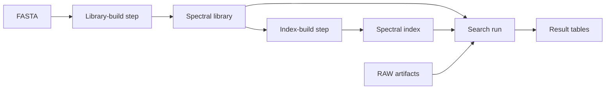

# Global artifacts and run lineage

Status: implemented; validation results and release checks appear below.
Date: 2026-10-20.

This feature is the final planned capability before users move ionflow into
production. It introduces shared, typed artifacts alongside run-specific tables.
It also moves all flow catalogs and run history under `<prefix>/runs/`.

There are no production users or production stores to migrate. Implement the new
layout directly. Do not add legacy layout detection, compatibility reads, or
migration tooling. Development stores can be recreated.

## Outcome

A run consumes a named combination of artifacts and scalar parameters. It can
produce tables, artifacts, or both. Several runs can consume the same artifact.
Each unique payload is stored once, independently of run folders.

Artifacts have stable types, editable names, and user-defined metadata. Lineage
records which steps consumed, generated, or reused them. Runs retain the artifact
IDs and metadata snapshots that they received.

The initial reference application is Snage. RAW files, FASTAs, spectral libraries,
and spectral indexes become artifacts. Search results remain run-specific tables.
The separate cleanup of Snage's ledger metadata is outside this plan.

## Evidence from Snage

The following paths are relative to the sibling `../inferys` checkout:

| Source | Current behavior | Design consequence |
| --- | --- | --- |
| `packages/snage/src/snage/ui.py`, `runs` and `App.state` | Combines ledger rows, result aggregates, and filesystem lookups. | Replace filesystem identity and association lookups with artifact queries. |
| `ui.py`, `library_info` | Reads metadata from manifests, `library.json`, writer logs, and dataset conventions. | Store explicit, typed library metadata and FASTA relationships. |
| `ui.py`, `index_info` | Resolves the parent library through a symlink. | Record the parent artifact explicitly. |
| `ui.py`, `run_setup` | Infers indexes from library, fragmentation method, and NCEs; omits loss settings from matching. | Record exact index IDs during execution, including searches with no identifications. |
| `cli.py`, `library_home_name` | Names libraries using a shortened hash of build inputs. | Derive artifact identity from completed content; keep build recipes separate. |
| `search.py`, `_index_locked` | Links library files into indexes and rebuilds indexes in place. | Share immutable blobs and build new index versions in work directories. |
| `home.py` | Syncs FASTAs, libraries, links, and ionflow runs using application-specific conventions. | Supply artifact-aware sync and recovery in ionflow. |

Libraries and indexes are multi-file directories. Libraries created with `--bases`
can share prediction files. File-only artifact support would not cover this use
case without duplicating large payloads.

## Storage layout

Use sibling namespaces for runs and artifacts. Keep the existing publish lake as
a third namespace. `ionflow` below is the default configurable prefix.

```text
ionflow/
  runs/
    <flow_id>/
      catalog.ducklake
      _lake/
      run_id=<run_id>/
        _meta.json
        _metrics*.parquet
        <step>/
          part_<key>.parquet

  artifacts/
    catalog.ducklake
    _lake/
    _blobs/
      sha256/<full-file-digest>
    fasta/<artifact-digest>/
      content.json
      _meta.json
      metadata/<revision>.json
    spectral-library/<artifact-digest>/
      content.json
      _meta.json
      metadata/<revision>.json
    spectral-index/<artifact-digest>/
      content.json
      _meta.json
      metadata/<revision>.json
    _links/<assertion-digest>.json
    _provenance/<activity-digest>/<revision-digest>.json

  published/
    ...
```

The flow root becomes `<prefix>/runs/<flow_id>`. A run directory becomes
`<flow-root>/run_id=<run_id>`. Do not retain another `runs/` level inside each
flow root.

Apply this layout to local stores and S3 stores. Scope flow discovery to
`<prefix>/runs/`. Update catalog discovery, run listing, metrics globs, sync,
recovery, tests, and documentation together.

Global sharing is scoped to one configured store and prefix. Artifact IDs contain
neither an absolute local path nor a bucket name. They survive sync between stores
and changes to the destination prefix.

## Identity and metadata

An artifact type declares a stable identifier, a payload kind, and metadata fields.
Support individual files and multi-file bundles. Keep type identifiers independent
of Python module paths and class names.

For a file, compute SHA-256 over all payload bytes. For a bundle, compute SHA-256
over a versioned, canonical manifest of relative filenames, sizes, and full file
digests. A typed artifact ID combines its stable type and content digest. Payload
kind and manifest version must be unambiguous in the identity scheme.

Store each unique file under `_blobs/sha256/`. Store the immutable artifact
descriptor as `content.json`. Bundle descriptors map relative filenames to blobs.
Two bundles can reference the same blob without duplicating its bytes.

Names, original source paths, timestamps, and editable properties do not affect
identity. Renaming an artifact preserves its ID. Changing payload bytes creates a
different artifact. Renaming a bundle member changes its content manifest because
the relative filename is part of the payload's structure.

Reuse the existing metadata declaration and validation conventions where they fit.
Persist custom metadata as JSON. Expose typed views over declared fields and retain
the underlying JSON for richer application metadata.

Duplicate imports return the existing artifact. They must not silently replace
conflicting metadata. Provide an explicit metadata update operation with revision
checks to prevent lost concurrent edits. Names are display values, not unique keys.

Runs pin metadata snapshots when binding artifacts. Workers receive those snapshots
rather than reading mutable current metadata during execution.

### Snage bundle boundaries

Define payload membership explicitly in the Snage adapter. A library excludes its
nested `indexes/`, `.used` stamps, locks, temporary files, and the provenance-only
`library.json` sidecar. Its application `manifest.json` remains part of its payload.
An index is a separate artifact.

Resolve existing file symlinks into content references when importing a bundle.
Shared files become shared blobs. Stored bundles must not depend on the original
filesystem layout. Validate relative paths and reject unsupported or unsafe link
structures at this boundary.

## Flow API

The following examples use the implemented public API.

```python
class Fasta(Artifact, kind="fasta"):
    organism: str | None


class SpectralLibrary(Artifact, kind="spectral-library", payload="bundle"):
    model: str
    protease: str
    max_length: int


class SpectralIndex(Artifact, kind="spectral-index", payload="bundle"):
    method: str
    nces: list[int]
    losses: list[str]


class BuildLibrary(Flow):
    class Inputs(ArtifactInputs):
        fasta: Fasta

    def library(self, fasta: Fasta) -> SpectralLibrary:
        output = predict(fasta.local_path())
        return SpectralLibrary.from_path(
            output,
            model="7.2",
            protease="Trypsin/P",
            max_length=30,
        )
```

An artifact return value describes a candidate payload. The runner validates,
persists, and binds it. A step's input signature declares its dependencies, just as
table dependencies work today.

Declare run inputs separately from scalar `Params`:

```python
class Identify(Flow):
    class Inputs(ArtifactInputs):
        raw_files: list[RawFile]
        library: SpectralLibrary
        indexes: list[SpectralIndex]

    # Table-producing steps follow.


Identify.run(
    artifacts={
        "raw_files": [raw_a.id, raw_b.id],
        "library": library.id,
        "indexes": [index.id],
    },
    params={...},
)
```

Support individual inputs and collections. Validate names, required values, types,
and referenced artifact existence before scheduling work. Explicit collection order
must survive serialization; item identity must not depend on collection position.

Artifact references expose their ID, pinned metadata, URI, and `local_path()`.
Materialize verified files or bundles into a shared local cache for native tools.
Keep cached payloads immutable and place locks, build output, and use stamps outside
them. Distinguish the cache from the canonical local store.

Support artifact dependencies through the existing fan-out and branch model. Carry
artifact IDs as durable item identities, retaining existing validation for duplicate
item keys. Keep distinct logical roles when the same content is bound more than once.

Some table-producing steps also create artifacts or select them dynamically. Snage's
search step currently creates indexes this way. Provide a tracked runtime operation
for named artifact inputs and outputs, with explicit parent references where needed.
Validate their types and report their events through the same worker result protocol
as ordinary artifact outputs. Do not infer these relationships from result rows.

## Lineage model



Record artifact ID, logical role, flow ID, run ID, step, and optional item key.
Distinguish declared run inputs, step consumption, generated outputs, and reused
outputs. Record explicit parent relationships for generated artifacts.

An artifact can have several producing activities. Two runs can produce identical
bytes from different inputs. Deduplicate the stored content while retaining both
provenance records. A single `creator_run_id` cannot represent this model.

Propagate artifact ancestry through intermediate tables. For example,
`FASTA -> peptide table -> library` must preserve the FASTA relationship. Keep
fan-out ancestry scoped to its item. Do not assign every input RAW file to every
branch's output.

Declared dependencies are the tracking contract. The system does not observe
operating-system file reads. Keep selected run inputs distinguishable from step
consumption, especially for failed or interrupted runs.

Explicitly imported relationships can exist without a producing ionflow run.
Keep their source distinguishable from execution-derived lineage. Do not invent a
producer when none is known.

## Catalog ownership and commits

| Authority | Owns |
| --- | --- |
| Shared artifact catalog | Artifact inventory, bundle membership, editable metadata, and explicitly imported relationships. |
| Per-flow catalog | Run bindings, step consumption, generation, reuse, and execution-derived parent relationships. |

Add fixed-schema artifact-binding and lineage tables to the flow catalog. Preserve
its role as the authority for run progress. Commit output bindings and lineage with
the step's manifest rows and completion state.

Use schrein and the existing `Store` dispatch for both catalogs. Keep schrein
independent of ionflow. Do not introduce a metadata service or a transaction spanning
separate catalogs.

Publish in this order:

```text
stage and hash payload
    -> upload missing blobs
    -> register the complete artifact
    -> commit run output bindings and lineage
```

Hash the same staged bytes that are uploaded. Use bounded-memory reads and the
existing multipart upload path. An incomplete bundle must never appear as a
registered artifact. Concurrent duplicate publication must be safe and idempotent.

A crash can leave unreferenced blobs or a registered artifact without a run binding.
It must not expose a completed step referencing an incomplete artifact. Workers
return artifact results and lineage events; the orchestrator owns run commits.

Extend run recovery exports with artifact bindings and lineage. Artifacts export
immutable numbered metadata revisions and a convenience `_meta.json` copy.
Recovery reads numbered revisions, so delayed exports cannot erase later edits.
Catalogs remain authoritative; exports serve recovery and sync.

## Resume and computation reuse

Artifact reuse and computation reuse are separate decisions:

- A fresh run can consume existing artifacts.
- Publishing identical bytes reuses storage.
- Selecting existing artifacts does not automatically reuse arbitrary table outputs.
- Resume inherits the origin's artifact IDs and metadata snapshots.
- Changing artifact inputs starts a fresh run.

Retain original production provenance when resuming an artifact output. Record its
reuse by the new run rather than claiming it was generated again.

Automatic build caching is deferred. If added later, its lookup key must include
input IDs, relevant settings, and code or tool versions. A recipe hash remains
separate from the completed artifact's content hash. Concurrent computations may
initially produce the same artifact; publication still deduplicates their storage.

## Query and command surface

Provide Python and CLI operations to import files or bundles, inspect artifacts,
update metadata, materialize payloads, and query lineage. Listing artifacts must work
before any consuming flow has run.

Expose SQL views for artifact inventory, bundle membership, run bindings, and
lineage. Support parent, producer, and consumer queries across flow classes. Attach
the artifact catalog alongside a flow's catalog when querying a flow.

Initially, derive cross-flow consumer queries from discovered flow catalogs. Add a
materialized global consumer index only if read costs justify it. Such an index
would be rebuildable, not a second authority for run lineage.

## Sync and recovery

Copy a run's referenced artifact closure before exposing the receiving run. Transfer
missing blobs and descriptors, preserve artifact IDs, and rebuild destination
catalogs with destination paths. A per-run sync must also follow table-part
references outside the requested run's folder.

Provide artifact-only sync for prepared inputs and libraries. Keep local and S3
behavior consistent. Detect conflicting concurrent metadata edits rather than
silently choosing a value.

Maintain catalog recovery from exported metadata and content descriptors. Validate
missing payload references during recovery. Recovery must retain generated and
reused relationships, including completed work from failed runs.

## Snage integration

Use RAW files, FASTAs, spectral libraries, and spectral indexes as the first concrete
artifact types. Preserve full model, digest, fragmentation, NCE, loss, and format
metadata. Replace path-based library identity with artifact bindings.

Build libraries and indexes in work directories and publish completed payloads.
Load registered indexes without rebuilding them in place. Record exact selected
index IDs during search, even when a search produces no identifications.

Keep the existing Runs, Libraries, and Indexes views. Populate their associations
from registry and lineage queries. Use artifact IDs in UI links and editable names
as labels. Derive use summaries from recorded consumption rather than `.used` files.

Replace the existing shared-artifact delete action with local cache eviction.
Permanent deletion requires reference checks across flows and bundle membership;
defer it until those semantics are implemented.

Update Snage's store and sync integration for the new layout. Keep its Preact and
htm implementation without a build step. Historical run association backfills and
conversion of old development stores are outside this plan.

## Implementation sequence

Implementation checklist:

- [x] Write ADRs 0022–0025 before implementation.
- [x] Move run keys and discovery into the runs namespace.
- [x] Add artifact schemas, inventory, publication and metadata edits.
- [x] Add verified, shared local materialization.
- [x] Bind typed flow inputs and support artifact step outputs.
- [x] Commit lineage and preserve failure, branch and resume semantics.
- [x] Expose artifact queries and CLI commands.
- [x] Add reference-aware sync and recovery.
- [x] Integrate Snage builders, workflow, sync and UI.
- [x] Complete focused checks, full suites and documentation.

1. Record architecture decisions for identity, bundles, ownership, and lineage.
   Implement the new run namespace and update all existing readers and writers.
2. Implement artifact schemas, references, the shared registry, hashing, file and
   bundle publication, metadata edits, and verified local materialization.
3. Extend DAG validation, run inputs, worker results, manifests, and catalog commits
   for artifact inputs and outputs. Cover fan-out, partial failure, and resume.
4. Add Python queries, SQL views, CLI commands, recovery, and artifact-aware sync.
5. Integrate Snage's builders, Identify workflow, sync, and existing UI views.

Expected ionflow touchpoints:

| Area | Files |
| --- | --- |
| Artifact definitions and registry | A new focused artifact module; split only when responsibilities require it. |
| Store access and new run layout | `store.py`, `space.py`; keep mode dispatch in `Store.of`. |
| Flow declarations and execution | `flow.py`, `dag.py`, `runner.py`, `state.py`, `plan.py`. |
| Catalogs, queries, and recovery | `lake.py`, `query.py`. |
| Public interfaces and discovery | `__init__.py`, `cli.py`, `tui.py`. |
| Contract and examples | Tests, README, bundled examples, and agent notes. |

## Validation and production readiness

The smallest complete acceptance scenario is:

```text
import FASTA
    -> build library
    -> build index
    -> run two searches using shared artifacts
    -> sync to another store
    -> inspect identical artifact IDs, metadata, and lineage
```

Use two different search combinations from a fixed artifact inventory. Confirm
distinct runs and shared payloads. Repeat the scenario locally and through the
supported S3 test backend.

Test ionflow's policies and trust boundaries:

- Identical bytes deduplicate despite different source names or paths.
- Changed bytes change identity; metadata edits do not.
- Bundle membership is deterministic and shared files upload once.
- Unsafe member paths and unsupported links fail before registration.
- Metadata updates validate types and detect stale revisions.
- Concurrent publication and replayed commits do not duplicate logical records.
- Interrupted publication never exposes incomplete artifacts as completed outputs.
- Failed runs retain completed outputs and their lineage.
- Resume preserves bindings, metadata snapshots, and original production provenance.
- Artifact ancestry survives intermediate tables and stays scoped to fan-out items.
- Sync and catalog recovery preserve identities and relationships.
- All run discovery and access use the new namespace and configurable prefix.
- Snage records the correct index when NCEs match but loss settings differ.

Extend pure planner tests first for resume policy. Use focused integration tests
for commits, publication, and worker behavior. Do not test pass-through guarantees
already supplied by hashing, Arrow, DuckDB, or schrein.

Run the full ionflow suite with `-m ""` for runner, CLI, or resume changes. Run
repo-wide Ruff and ty checks. Run the relevant Snage package tests and manually
check its existing UI. Preserve the deliberate absence of ionflow TUI tests.

Release readiness requires the acceptance scenario, the failure and recovery
checks, and documentation of the final public API and storage contract.

### Implementation validation

Validation on 2026-10-20 covers:

- 189 passing ionflow tests, including the full slow suite and doctests.
- 165 passing Snage tests and doctests on Python 3.12.
- Local and subprocess-backed S3 publication, sync, recovery, failure and resume.
- Concurrent publication, stale metadata edits, corrupt downloads and interrupted uploads.
- Intermediate-table ancestry, item scope and several independently published fan-out outputs.
- The shipped artifact example through import, execution, SQL, metadata edit and resume.
- Snage's exact index selection with identical NCEs and different loss settings.
- Chrome checks of all three lists, detail routes and creation/settings dialogs, without JavaScript exceptions.
- Successful ionflow, schrein and Snage wheel builds.
- Clean repository-wide ionflow Ruff and ty checks, and clean Snage Ruff checks.

Snage's gradual type check still reports eight warnings in native bindings and existing table-processing code.
Native scientific searches were not rerun against a representative production dataset.
The integration tests use controlled payloads and a stand-in library writer.
Run a real RAW/FASTA/library/index acceptance scenario before the production release.

Snage pins the matching ionflow Git commit. Publish the ionflow feature branch
before installing the Snage branch on another machine. No main branch changes,
legacy-store migrations or canonical artifact deletions are part of this work.

## Existing architectural foundations

- [Per-flow catalogs](../decisions/0012-per-flow-ducklake-catalog.md).
- [Local stores and sync](../decisions/0016-local-store-mode.md).
- [One transactional authority for run metadata](../decisions/0019-one-transactional-metadata-store.md).
- [Manifest-based runs and cross-run part references](../decisions/0020-runs-are-manifests-resume-references.md).
- [Worker execution and orchestrator-owned commits](../decisions/0021-one-scheduler-user-code-in-workers.md).

The new run layout updates the path conventions in those records. Their catalog,
reference, and execution invariants remain the foundation for this feature.
